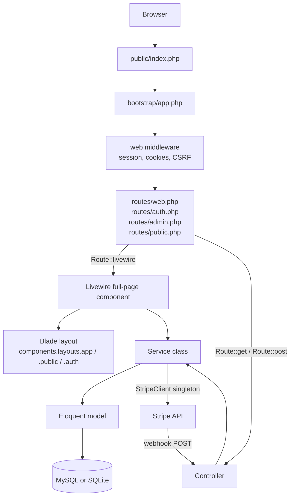

The application is a conventional Laravel monolith with a Livewire front end. There is no
SPA, no separate API and no client-side router beyond Livewire's `wire:navigate`. Every page
is rendered on the server from a Blade layout.

## Request flow



`bootstrap/app.php` registers the four route files, sets `redirectGuestsTo(route('login'))`,
exempts `stripe/webhook` from CSRF validation and registers the `/up` health check. The
`api` route file is not registered.

## Layers

| Layer | Location | Responsibility |
| --- | --- | --- |
| Routing | `routes/*.php` | Maps URIs to full-page Livewire components or controllers |
| Presentation | `app/Livewire/**` + `resources/views/livewire/**` | Component state, validation, actions, Blade markup |
| Layouts | `resources/views/components/layouts/{app,public,auth}.blade.php` | Chrome, navigation, `@vite`, flash messages |
| Controllers | `app/Http/Controllers` | Non-Livewire endpoints: webhook, Connect redirects, CSV/XLSX export, PDF, logout |
| Domain services | `app/Services` | Order lifecycle, references, Stripe Connect/checkout/refund |
| Support | `app/Support` | Money formatting, QR generation |
| Models | `app/Models` | Eloquent relationships, casts, small domain helpers |
| Enums | `app/Enums` | `EventStatus`, `OrderStatus`, `DiscountType`, `QuestionType` |
| Policies | `app/Policies` | Ownership checks for organiser-scoped models |

Livewire components are the default place for behaviour. A component queries through
relationships or calls a service; it does not contain Stripe HTTP calls. `Checkout` calls
`OrderService::createReservation` and `CheckoutService::createPaymentIntent`; the admin
order screen calls `RefundService::refund` and `OrderService::markRefunded`.

## Full-page components

`Route::livewire()` maps a URL directly to a component class:

```php
Route::livewire('/e/{event}', EventPage::class)->name('events.show');
Route::livewire('/e/{event}/checkout', Checkout::class)->name('checkout');
```

Each component declares its layout with an attribute, for example
`#[Layout('components.layouts.public')]` on every `App\Livewire\Public\*` class and
`#[Layout('components.layouts.app')]` on every admin screen. `mount()` performs route model
binding, policy checks and initial queries; public actions re-check authorization before
mutating anything.

`App\Livewire\Public\Checkout` uses `#[Locked] public Event $event` so the bound model cannot
be swapped by a crafted request. Admin components bind models without `#[Locked]` because a
`mount()` policy check already rejects other users' records.

## Service container

`App\Providers\AppServiceProvider` does two things:

```php
$this->app->singleton(StripeClient::class, fn () => new StripeClient(config('services.stripe.secret')));

Gate::guessPolicyNamesUsing(fn (string $model) => 'App\\Policies\\'.class_basename($model).'Policy');
```

- `StripeClient` is a singleton, so `ConnectService`, `CheckoutService` and `RefundService`
  share one client and can be constructor-injected or resolved with `app(...)`.
- Policy discovery is by naming convention: `App\Models\Event` → `App\Policies\EventPolicy`.
  There is no policy registration map. See [authorization](authorization.md).

Services are concrete classes with no interfaces. They are resolved by the container and
receive the Stripe client by constructor promotion.

## Rendering and assets

- `resources/views/components/layouts/app.blade.php` is the authenticated dashboard shell
  with a sidebar and sign-out form.
- `components.layouts.public` is the storefront shell used by event, checkout, confirmation
  and ticket pages.
- `components.layouts.auth` is the centred card used by the four auth screens.
- All three call `@vite(['resources/css/app.css', 'resources/js/app.js'])`. Tailwind 4 is
  configured in `resources/css/app.css`; `resources/js/app.js` is intentionally empty.
- The public layout does not include Stripe.js. The checkout Blade view calls the global
  `Stripe(...)` constructor, so a deployment must load `https://js.stripe.com/v3` (for
  example in `components.layouts.public`) for the payment step to work.

## Boundaries

- No jobs other than `App\Jobs\SendAttendeeMessages`; mail is otherwise queued directly
  through Laravel's mail queue.
- No custom events, listeners or broadcasting; state changes happen synchronously inside
  services or the webhook controller.
- No artisan schedule is defined, so nothing runs on a timer. See
  [deployment and operations](deployment-and-operations.md).
- The only JSON-producing behaviour is error rendering for requests that expect JSON
  (`withExceptions()->shouldRenderJsonWhen`); there are no API routes.
