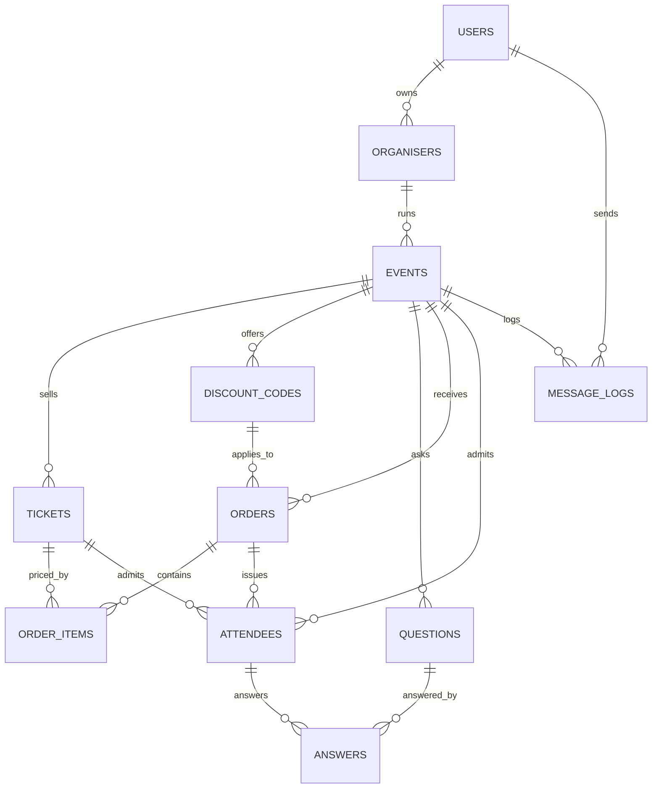

The domain is small and relational: a user owns organisers, organisers run events, events
sell tickets, and orders produce attendees. All money columns are integer minor units.

## Entity relationships

## Models

| Model | Table | Route key | Soft deletes | Notes |
| --- | --- | --- | --- | --- |
| `User` | `users` | `id` | No | `organisers()` has-many; `#[Fillable]`/`#[Hidden]` attributes |
| `Organiser` | `organisers` | `slug` | Yes | Unique slug generated on create; Stripe state columns |
| `Event` | `events` | `slug` | Yes | Unique per organiser (`organiser_id` + `slug`) |
| `Ticket` | `tickets` | `id` | No | Ordered by `sort_order` on `Event::tickets()` |
| `DiscountCode` | `discount_codes` | `id` | No | Codes upper-cased on create and update |
| `Order` | `orders` | `reference` | No | `ORD-` + 8 characters |
| `OrderItem` | `order_items` | `id` | No | Snapshot of ticket title and price |
| `Attendee` | `attendees` | `reference` | Yes | `TKT-` + 10 characters |
| `Question` | `questions` | `id` | No | Ordered by `sort_order` on `Event::questions()` |
| `Answer` | `answers` | `id` | No | Belongs to attendee and question |
| `MessageLog` | `message_logs` | `id` | No | Audit row for a bulk message |

## Column reference

### Organiser

| Column | Type | Purpose |
| --- | --- | --- |
| `user_id` | FK → `users` | Owner; all policy checks compare this |
| `name`, `slug`, `email`, `phone`, `about`, `logo_path` | strings/text | Public identity |
| `currency_code` | `char(3)` | Default currency for new events |
| `timezone` | string | Default event timezone |
| `stripe_account_id` | string, nullable, indexed | Connected account id (`acct_...`) |
| `stripe_charges_enabled` | boolean | Set from `configuration.merchant.capabilities.card_payments.status` |
| `stripe_details_submitted` | boolean | No outstanding `currently_due` requirements |
| `stripe_onboarded_at` | timestamp, nullable | First time both flags became true |
| `platform_fee_percent` | `decimal(5,2)`, nullable | Overrides the global fee |

### Event

| Column | Type | Purpose |
| --- | --- | --- |
| `organiser_id` | FK → `organisers` | Owner |
| `title`, `slug`, `description`, `cover_image_path` | | Public content |
| `start_date`, `end_date` | datetime, UTC | Stored after converting from the event timezone |
| `timezone` | string | Display timezone |
| `venue_name`, `address1`, `city`, `state`, `postal_code`, `country_code`, `latitude`, `longitude` | | Venue |
| `currency_code` | `char(3)` | Copied from the organiser on create |
| `status` | `draft` / `live` / `ended` | Cast to `EventStatus` |
| `is_public` | boolean | Must also be true for the public pages |
| `max_attendees` | unsigned int, nullable | Stored but **not enforced** by checkout or `OrderService` |

`status` is not set to `ended` anywhere in the application; `Event::hasEnded()` derives
"ended" from `end_date` instead.

### Ticket, discount code, question

| Table | Key columns |
| --- | --- |
| `tickets` | `event_id`, `title`, `price` (minor), `quantity_available` (`null` = unlimited), `quantity_sold`, `min_per_order`, `max_per_order`, `sales_start_at`, `sales_end_at`, `is_hidden`, `sort_order` |
| `discount_codes` | `event_id`, `code` (unique per event), `type` (`percentage` / `fixed`), `value`, `quantity_available`, `quantity_used`, `min_quantity`, `expires_at`, `is_active` |
| `questions` | `event_id`, `title`, `type` (`text` / `select` / `checkbox`), `options` JSON, `is_required`, `applies_to`, `sort_order` |

For a percentage code, `value` is whole percent (for example `10`); for a fixed code it is
minor units. `applies_to` accepts `attendee` or `order` in the admin validation, but checkout
renders every question per attendee, so `order` questions are not implemented differently.

### Order, item, attendee

| Table | Key columns |
| --- | --- |
| `orders` | `reference` unique, `event_id`, `organiser_id`, `status`, `first_name`, `last_name`, `email`, `subtotal`, `discount_total`, `tax_total`, `total`, `currency_code`, `discount_code_id`, `stripe_payment_intent_id` unique, `stripe_account_id`, `application_fee_amount`, `refunded_amount`, `paid_at`, `refunded_at`, `cancelled_at` |
| `order_items` | `order_id`, `ticket_id` (nullable, `nullOnDelete`), `description`, `unit_price`, `quantity`, `total` |
| `attendees` | `order_id`, `event_id`, `ticket_id` (nullable), `first_name`, `last_name`, `email`, `reference` unique, `is_cancelled`, `is_refunded`, `checked_in_at`, `checked_in_by` FK → `users`, `deleted_at` |

`tax_total` is not calculated by the checkout; it is present in the schema for future tax
support and is displayed on the admin order page when greater than zero.

## Model helpers worth knowing

| Helper | Behaviour |
| --- | --- |
| `Event::scopePublished` | `status = live` **and** `is_public = true` |
| `Event::scopeUpcoming` | `start_date >= now()` |
| `Event::visibleTickets` | `tickets()` with `is_hidden = false` |
| `Event::coverImageUrl` / `Organiser::logoUrl` | `asset('storage/...')` |
| `Event::revenueMinor` | Sum of `total` for completed orders |
| `Event::ticketsSold` | Attendees that are not cancelled |
| `Ticket::remaining` | `quantity_available - quantity_sold`, or `null` when unlimited |
| `Ticket::isOnSale` | Visible, not sold out, within the sales window |
| `DiscountCode::isUsable` | Active, unexpired, has remaining uses |
| `DiscountCode::discountFor` | Rounds percentages, clamps to the subtotal |
| `Order::isRefundable` | Completed, not fully refunded, has a payment intent |
| `Order::refundableMinor` | `total - refunded_amount`, floored at zero |
| `Order::netToOrganiserMinor` | `total - application_fee_amount` |
| `Attendee::name` / `isCheckedIn` | Display name and check-in flag |

Slugs are generated in model `booted()` hooks (`Event::uniqueSlug`,
`Organiser::uniqueSlug`) and are never regenerated on rename. References come from
`App\Services\ReferenceGenerator`.

Every domain table has `created_at`/`updated_at`. Foreign keys cascade on delete except
`order_items.ticket_id` and `attendees.ticket_id`, which are nullable with `nullOnDelete`.
