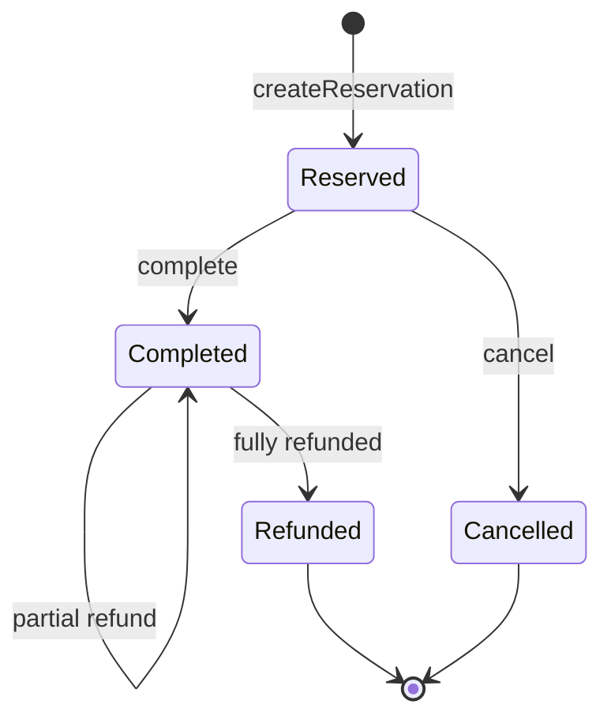
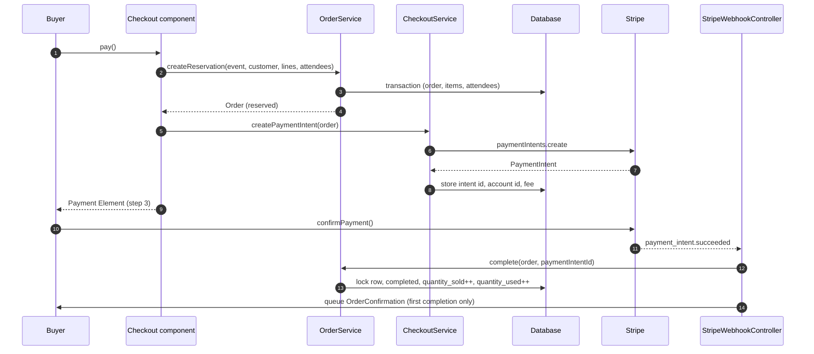

An order moves through four statuses defined in `App\Enums\OrderStatus`: `reserved`,
`completed`, `cancelled` and `refunded`. `App\Services\OrderService` owns every transition;
Livewire components and the Stripe webhook controller call it rather than writing statuses
directly.

## States and transitions

| From | To | Trigger | Code |
| --- | --- | --- | --- |
| — | `reserved` | Checkout submission | `OrderService::createReservation` |
| `reserved` | `completed` | `payment_intent.succeeded`, or a zero-total order | `OrderService::complete` |
| `reserved` | `cancelled` | `payment_intent.payment_failed`, `payment_intent.canceled`, Stripe intent creation failure, or admin cancel | `OrderService::cancel` |
| `completed` | `completed` | Partial refund | `OrderService::markRefunded` / `syncRefunded` |
| `completed` | `refunded` | Refund total reaches `total` | `OrderService::applyRefundedTotal` |
| `refunded` | `refunded` | Further webhook retries | No-op by the monotonic guard |

There is no path back from `cancelled` or `refunded` to an active state.

## Checkout to completion

## `createReservation`

`OrderService::createReservation(Event $event, array $customer, array $lines, array $attendees = [], ?string $discountCode = null)`
validates before writing anything:

1. `$event->isLive()` — draft and ended events cannot be booked.
2. At least one line remains after `array_filter(array_map('intval', $lines))`.
3. Every ticket id belongs to the event.
4. `Ticket::isOnSale()` — visible, not sold out, inside the sales window.
5. Quantity is within `min_per_order` and `max_per_order`.
6. Quantity does not exceed `Ticket::remaining()` when the ticket is capped.
7. A discount code, if supplied, exists for the event, is `isUsable()` and the total quantity
   meets `min_quantity`.

Failures throw `ValidationException` with keys `tickets` or `discount_code`, which the
checkout renders as field errors.

Inside `DB::transaction` it creates:

- an `Order` with status `reserved`, reference `ORD-` + 8 characters, currency from the
  event, `subtotal`, `discount_total` and `total`;
- one `OrderItem` per ticket line, snapshotting title, unit price, quantity and total;
- one `Attendee` per ticket, each with `TKT-` + 10 characters.

When the caller supplies no attendee rows, `createAttendees` generates one per purchased
quantity from the customer's name and email. Answer rows are created for non-empty values;
array answers are joined with `, `.

## `complete`

`OrderService::complete(Order $order, ?string $paymentIntentId = null)`:

- opens a transaction and re-reads the order with `lockForUpdate()`;
- returns immediately when the order is already `completed`, which makes webhook retries
  idempotent;
- throws a `ValidationException` when the status is not `reserved`;
- sets `status`, `paid_at` and the payment intent id;
- increments `tickets.quantity_sold` by each item quantity;
- increments `discount_codes.quantity_used` when the order used a code.

`Checkout::pay` calls `complete()` directly for zero-total orders and redirects to the
confirmation page, so no Stripe interaction is needed for free tickets.

## `cancel`

`OrderService::cancel` only acts on `reserved` orders. It force-deletes the order's attendees
(they were placeholders, not issued tickets) and sets `status = cancelled` with
`cancelled_at`. It does not touch `quantity_sold`, because stock is only incremented at
completion.

## Refunds

| Method | Effect |
| --- | --- |
| `markRefunded(Order, int $amountMinor)` | Adds to `refunded_amount`, capped at `total` |
| `syncRefunded(Order, int $absoluteAmountMinor)` | Sets `refunded_amount` to Stripe's absolute value, capped at `total` |
| `applyRefundedTotal` (private) | Writes the amount, sets `refunded` and `refunded_at` when full, flags attendees `is_refunded` |

Both public methods ignore a value lower than the current `refunded_amount`, so out-of-order
webhooks and retries cannot reduce the refunded total. A partial refund leaves the status as
`completed`; only a full refund sets `refunded`. Refunds do not decrement `quantity_sold`, so
refunded stock is not automatically resold.

## Check-in

`OrderService::checkIn(Attendee, ?User)` returns `false` and changes nothing when the attendee
is cancelled or refunded, when the order is not completed, or when the attendee is already
checked in. On success it sets `checked_in_at` and `checked_in_by`.

## Known constraints

- Stock is checked by reading `quantity_sold` and only incremented in `complete()`. There is
  no lock or database constraint tying the two together, so two simultaneous checkouts can
  both pass the remaining-stock check for the last ticket.
- Cancelled and refunded orders are terminal. There is no reissue or duplicate-order flow.
- `OrderService` does not enforce `events.max_attendees`.
- Statuses are persisted as strings; the enum is applied through the model cast, so raw
  queries comparing statuses use the enum value (for example `where('status', 'completed')`).
