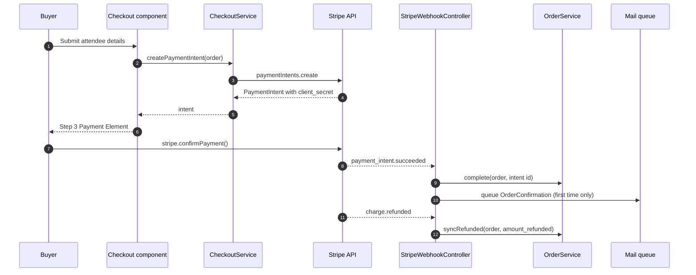

Payments are **destination charges**. The platform account creates the PaymentIntent; Stripe
transfers the net amount to the organiser's connected account and retains the
`application_fee_amount` for the platform. Payment state is authoritative in Stripe and is
mirrored to orders by the webhook endpoint.

## Payment flow



## Creating the PaymentIntent

`CheckoutService::createPaymentIntent(Order $order)` sends a **destination charge** when
`$order->organiser->stripeReady()`. When the organiser has no connected account (or cannot
take charges yet), it charges the **platform account configured in `.env`** instead: no
`transfer_data` and no `application_fee_amount`, so the money stays in the platform balance
and the organiser is settled outside Stripe. `orders.stripe_account_id` is `null` for those
orders, which is how refunds know there is no transfer to reverse.

It calls `paymentIntents->create` with:

| Parameter | Value |
| --- | --- |
| `amount` | `orders.total` in minor units |
| `currency` | `strtolower($order->currency_code)` |
| `automatic_payment_methods` | `['enabled' => true]` |
| `application_fee_amount` | `round(total * feePercent / 100)`, clamped to `total` |
| `transfer_data.destination` | `organiser.stripe_account_id` |
| `metadata.order` | `orders.reference` |
| `metadata.event_id` | Event id as a string |
| `metadata.organiser_id` | Organiser id as a string |
| `receipt_email` | `orders.email` |

The idempotency key is `order-{reference}`, so retrying the component action cannot create a
second intent for the same order. After the call the order stores
`stripe_payment_intent_id`, `stripe_account_id` and `application_fee_amount`.

The browser side lives in `resources/views/livewire/public/checkout.blade.php`: it creates
`stripe.elements({ clientSecret })`, mounts the `payment` element into `#payment-element`,
and calls `stripe.confirmPayment({ elements, confirmParams: { return_url }, redirect: 'if_required' })`.
The publishable key comes from `config('services.stripe.key')`.

:::warning[Stripe.js]
No Blade layout in the repository includes `https://js.stripe.com/v3`. The checkout script
calls the global `Stripe(...)`, so the script tag must be loaded (for example in
`resources/views/components/layouts/public.blade.php`) in any environment where checkout is
used. Without it, step 3 fails with `Stripe is not defined`.
:::

## Webhook endpoint

`POST /stripe/webhook` → `App\Http\Controllers\StripeWebhookController::handle`. The route is
CSRF-exempt (`bootstrap/app.php`), registered in `routes/public.php`, and has no
authentication: the signature is the authentication.

`parseEvent()`:

- when `STRIPE_WEBHOOK_SECRET` is blank, decodes the JSON body and constructs a `Stripe\Event`
  without verification (local convenience only);
- otherwise calls `Stripe\Webhook::constructEvent` with the raw body and the `Stripe-Signature`
  header;
- returns `null` on invalid JSON, an unexpected payload or `SignatureVerificationException`.
  The controller then responds `400 Invalid payload or signature`.

A successfully parsed event always yields `200 ok`, including event types the app does not
handle, so Stripe does not retry them.

## Handled events

| Event | Lookup | Action |
| --- | --- | --- |
| `payment_intent.succeeded` | `metadata.order` reference, else `stripe_payment_intent_id` | `OrderService::complete`; queue `OrderConfirmation` only when the order was not already completed |
| `payment_intent.payment_failed` | Same | `OrderService::cancel` (no-op unless reserved) |
| `payment_intent.canceled` | Same | `OrderService::cancel` |
| `charge.refunded` | `stripe_payment_intent_id` = `charge.payment_intent` | `OrderService::syncRefunded` with absolute `amount_refunded` |
| `account.updated` | `organisers.stripe_account_id` = event object id | `ConnectService::refreshStatus`; API errors are reported and still acknowledged |

`account.updated` is still emitted by Stripe for v2 accounts. The handler treats the event as
a signal only and re-reads the account through Accounts v2 with the `include` list; the v1
payload is never trusted. Accounts v2 **thin** events are not subscribed to.

## Idempotency and ordering

- `OrderService::complete` locks the order row and returns early if it is already completed,
  so duplicate `payment_intent.succeeded` events are harmless and do not send a second email.
- `syncRefunded` treats `amount_refunded` as an absolute total and ignores smaller values, so
  `charge.refunded` can arrive more than once without double counting.
- The refund idempotency key is
  `refund-{reference}-{refunded_amount}-{amount}`, which distinguishes successive partial
  refunds while making a retry of the same refund safe.
- Unhandled event types are acknowledged, not stored. There is no webhook event log table.

## Refunds

`App\Services\Stripe\RefundService::refund(Order $order, ?int $amountMinor = null)`:

- requires `Order::isRefundable()` (completed, not fully refunded, has a payment intent);
- defaults the amount to `refundableMinor()` and clamps it to that value;
- rejects zero or negative amounts with a `ValidationException`;
- calls `refunds->create` with `payment_intent`, `amount`, `refund_application_fee`
  (only when the stored fee is greater than zero) and `reverse_transfer: true`.

The admin order screen calls `RefundService::refund` and then `OrderService::markRefunded`
optimistically; the `charge.refunded` webhook later reconciles the absolute total. If the
refund API call succeeds but the redirect or action fails, the webhook still records it.

## Local testing

```bash
stripe listen \
  --events payment_intent.succeeded,payment_intent.payment_failed,payment_intent.canceled,charge.refunded,account.updated \
  --forward-to localhost:8000/stripe/webhook

The CLI prints its signing secret (`whsec_...`) on startup; copy it into
`STRIPE_WEBHOOK_SECRET`. Current CLI versions require `--events` (or `--all-snapshot`), and the
app ignores events it does not handle, so listing the five above is enough.
```

Copy the printed `whsec_...` into `STRIPE_WEBHOOK_SECRET` and restart the app. With an empty
secret, hand-crafted `curl` payloads are accepted without a signature:

```bash
curl -X POST http://localhost:8000/stripe/webhook \
  -H 'Content-Type: application/json' \
  -d '{"id":"evt_local","type":"payment_intent.succeeded","data":{"object":{"id":"pi_local","metadata":{"order":"ORD-XXXXXXXX"}}}}'
```

Feature tests use `Tests\Support\FakeStripeHttpClient` at the Stripe HTTP layer, so they
never call the network. See [testing](testing.md).
